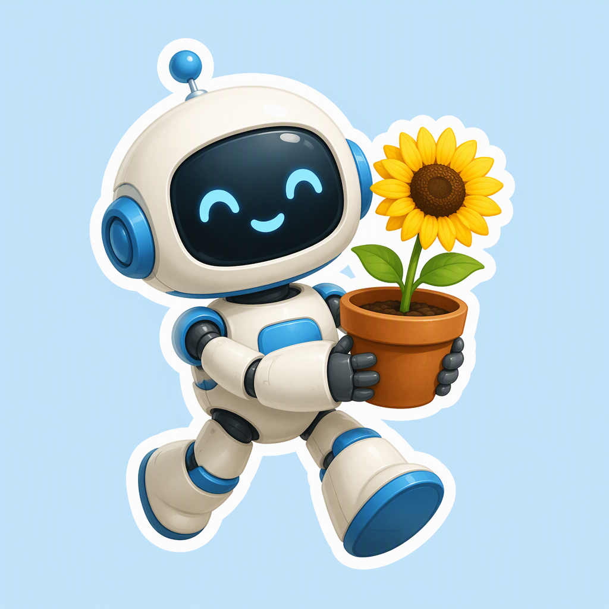

# Lower-cost Telegram AI Bot API recipes

[中文](README_zh-CN.md) · [Upstream](https://github.com/harshitethic/chatgpt-bot-telegram) · [Prices and call costs](PRICING.md)

Real image API generation and Buffer conversion tested against the existing image-service boundary; Telegram delivery and text models are not tested. No native video command exists in the inspected source.

## Examples



gpt-image-2(VIP), low / 1K: current price **$0.0019/image**; this image settlement is pending.

## Run

Set `TOAPIS_API_KEY` privately on the server. Python 3.10+, standard library only for API calls.

```sh
python unified_client.py --model gpt-image-2-vip --prompt-file prompts/image.txt --max-usd .10
# Review quotation, then explicitly submit once:
python unified_client.py --model gpt-image-2-vip --prompt-file prompts/image.txt --max-usd .10 --live --run-id reviewed-image-01
```

Repeating a run with the same stable identity resumes its task. Uncertain submissions are not automatically resubmitted. Keep `.state` private. Seedance Global models are disabled.

# Model pricing and call cost

2026-10-23 · USD · ToAPIs international site (.com). Sorted by call amount; pending image quotes are labeled.

| Model | Conditions | Current API price | This call |
|---|---|---:|---:|
| gpt-image-2(VIP) | low / 1K / 1 image | $0.0019/image | Settlement pending; quote $0.0019 |

Image price is a Key-scoped quotation; do not treat the missing settlement as zero. Video is .com `billing=settled`; $/s = this settled cost / decoded duration. Token rates are not flat per-second tariffs.

## Provider contribution

[Integration details and acceptance checklist](integration/README.md) · [Attribution and inspected source](UPSTREAM.md).

[Register at ToAPIs](https://toapis.com/login?aff=BEWR)

[Model API reference](https://docs.toapis.com/docs/cn/api-reference/images/gpt-image-2-vip/generation)
